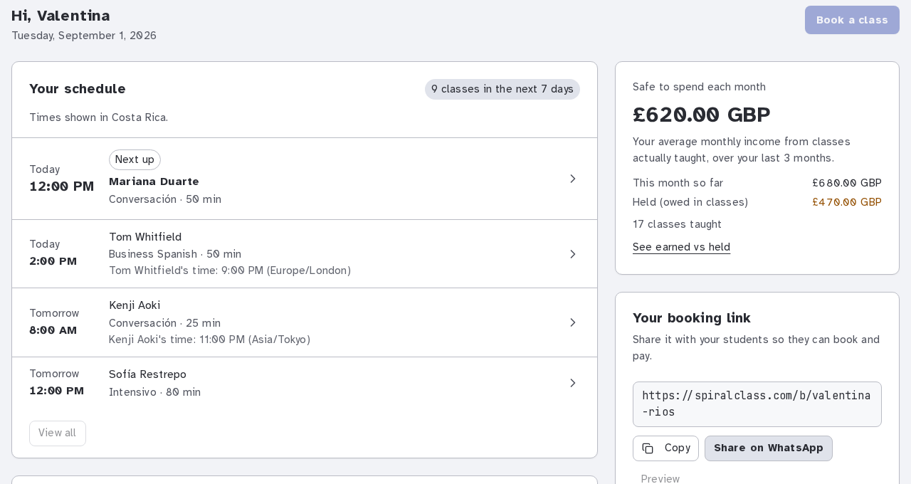
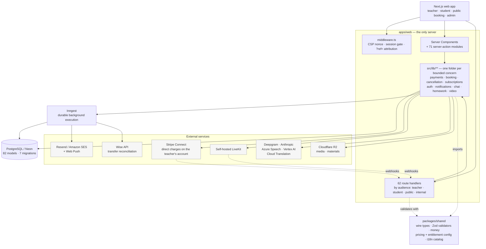
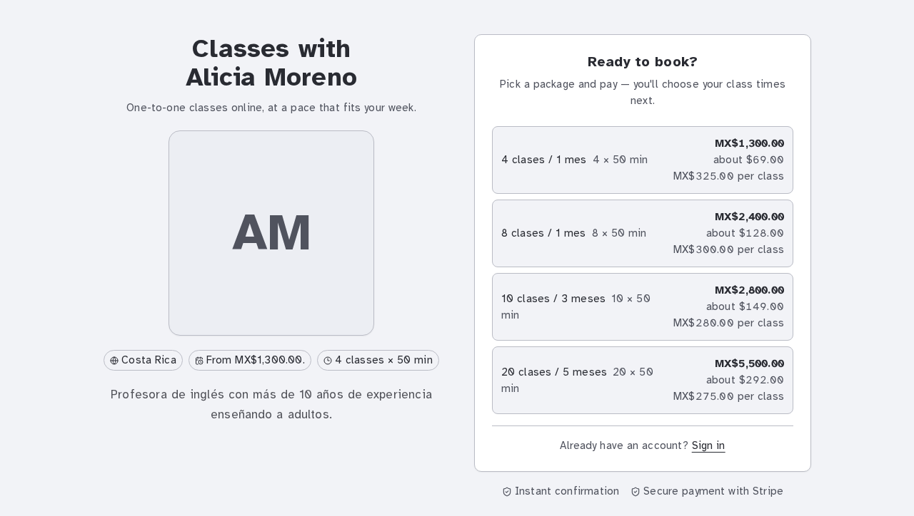
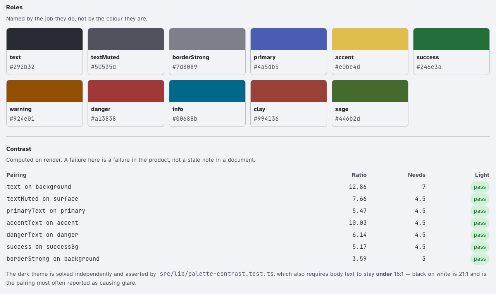
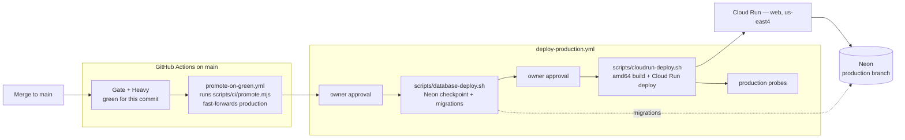

# SpiralClass

[](https://github.com/jaystewartuk/spiralclass/actions/workflows/gate.yml)
[](LICENSE)

<!-- The production deploy deliberately has no badge: it waits on the owner's
     approval (D-199), so a green badge would mostly mean "nothing has been
     approved lately". Preview has no deploy workflow at all (D-184). -->

**A scheduling, payments and video platform for independent teachers of any
subject.** It runs in production at [spiralclass.com](https://spiralclass.com)
on live payment rails, with real teachers and their students on it, and this
repository is the whole of it.

A teacher signs up, sets her availability, publishes a booking page, and sells
packages of classes. Her students buy a package, book slots against it, join
the lesson in the browser, and get homework and materials afterwards. She gets
paid — either by card through her own Stripe account, or by Wise transfer
against instructions the platform generates and reconciles. Nobody installs
anything.

[](https://spiralclass.com/demo)

<sub>The teacher dashboard as it really renders, captured from
[`spiralclass.com/demo`](https://spiralclass.com/demo) — a public page that
draws the production component from invented data rather than opening a demo
account ([D-142](docs/decisions/D-142.md)). No real person, class or figure
appears in it.</sub>

---

## Where to start

| If you want to…                       | Read                                                                                                                             |
| ------------------------------------- | -------------------------------------------------------------------------------------------------------------------------------- |
| understand how it is built            | [Architecture overview](docs/architecture/overview.md)                                                                           |
| understand why it is built that way   | [Two decisions, told in full](docs/decisions/READ-THIS-FIRST.md) — one page, then [the log](docs/decisions/README.md#start-here) |
| run it on your machine                | [Development setup](docs/development/setup.md) — or `pnpm setup && pnpm dev`                                                     |
| understand the database               | [Data model](docs/architecture/data-model.md)                                                                                    |
| see what it does, feature by feature  | [Feature documentation](docs/features/)                                                                                          |
| find any other document               | [The documentation map](docs/README.md)                                                                                          |
| know what is exposed by publishing it | [Security posture](docs/security.md)                                                                                             |

> [!NOTE]
> **How this repository was built.** SpiralClass was built by one person working
> with AI coding agents; most of the code was agent-written under review. The
> public history starts from a sanitised working-tree snapshot
> ([why](docs/security.md#a-note-on-git-history)); every change since lands here
> as a pull request.

---

## Why this repository is public

It is published as an honest record of how one engineer builds and runs a
payments-handling, video-carrying SaaS product alone: the architecture, the
decisions, the things that went wrong, and the mechanisms built so they would
not go wrong twice. More than 25 decision records in
[`docs/decisions/`](docs/decisions/README.md) are the most useful thing here —
several of them reverse an earlier one and say why.

**No code was simplified, staged or rewritten for presentation.** What you are
reading is what serves production. The decision log is curated, and says so:
records were removed before publication, numbers were never reused, and
[the index says which groups went and why](docs/decisions/README.md#what-is-not-here).

This is a live system, and it is also **small**: a solo-built product with a
customer base measured in individuals, not thousands. There is no team, no
on-call rotation, and no uptime SLA. The engineering is sized for correctness
and for one person being able to hold it in their head — not for scale it does
not have.

## Technology

| Layer                  | What is used                                                                                                                                                                                                                 |
| ---------------------- | ---------------------------------------------------------------------------------------------------------------------------------------------------------------------------------------------------------------------------- |
| Language               | TypeScript, end to end, `strict`                                                                                                                                                                                             |
| Web                    | Next.js 16 (App Router, React Server Components), React 19, Tailwind, Radix primitives                                                                                                                                       |
| Database               | PostgreSQL on [Neon](https://neon.tech), accessed through Prisma                                                                                                                                                             |
| Auth                   | [better-auth](https://better-auth.com) — email one-time codes and Google Sign-In                                                                                                                                             |
| Payments               | Stripe Connect (Accounts v2, direct charges) and a Wise transfer rail with API reconciliation                                                                                                                                |
| Video                  | Self-hosted [LiveKit](https://livekit.io) — WebRTC lessons; room-composite Egress recording exists and is off in production                                                                                                  |
| Speech / AI            | Browser speech recognition with Deepgram as fallback (captions and transcripts), Google Cloud Translation, Anthropic Claude (lesson insights, material composition), Azure Speech (pronunciation), Google Vertex AI (images) |
| Background jobs        | [Inngest](https://inngest.com) — 31 background functions                                                                                                                                                                     |
| Storage                | Cloudflare R2 (S3-compatible), signed via `aws4fetch`                                                                                                                                                                        |
| Email                  | Resend, with Amazon SES as a swappable second provider                                                                                                                                                                       |
| Observability          | Sentry, PostHog                                                                                                                                                                                                              |
| Hosting                | Google Cloud Run (Docker, standalone Next output), Cloudflare DNS                                                                                                                                                            |
| Infrastructure as code | OpenTofu — R2 buckets and Amazon SES; [`infra/`](infra/README.md) lists every module                                                                                                                                         |
| Tooling                | pnpm workspaces, Turborepo, Vitest, Playwright, ESLint, Prettier                                                                                                                                                             |

## Architecture



The shape is deliberately unfashionable: **one Next.js application, one
database, no service mesh.** There is no queue broker to run, no separate API
tier, and no microservice boundary that a solo maintainer would have to keep
honest. The only things that leave the process are Inngest (durable background
execution) and the video plane.

Route groups partition by **audience, not URL**: a student can belong to
several teachers, so there is no "current teacher" in the student tree at all.
`src/lib/<domain>/` holds one folder per bounded concern with its tests beside
it, and `packages/shared` holds the rules the route handlers and the UI must
agree on. The [architecture overview](docs/architecture/overview.md) has the
detail.

## What the product does

Everything listed here is implemented and in production. Each links to its
canonical behaviour document.



<sub>The public funnel a teacher sends her students to, rendered from seed
fixtures on a local checkout — the page and the checkout beside it are the two
routes `pnpm setup && pnpm dev` serves with no Stripe key present. The teacher
is invented; her packages, prices and
copy are hers to set. The chrome is English because <em>her buyers</em> read
English, while her own bio is the Spanish she wrote it in — those are two
different columns, and
[the i18n section below](#internationalisation-and-four-different-languages-per-teacher)
is about why.</sub>

- **[Scheduling, booking and cancellation](docs/features/scheduling-booking.md)**
  — weekly availability, per-date overrides, timezone-correct slots, Google
  Calendar busy-import, double-booking prevention, and a cancellation policy
  engine.
- **[Packages](docs/features/packages.md)** — a teacher sells N classes valid
  for M months; bookings draw down a balance.
- **[Payments](docs/features/payments.md)** — card via Stripe Connect direct
  charges on the teacher's own account, or Wise transfer with API
  reconciliation.
- **[Live video lessons and captions](docs/features/live-calls-video.md)** —
  WebRTC in the browser, with live captions translated into the listener's
  language.
- **[Lesson insights](docs/features/lesson-insights-reports.md)** — with the
  pairing's consent, the class's caption text becomes focus areas and a brief.
- **[Homework](docs/features/homework.md)**,
  **[library materials](docs/features/library-materials.md)** and
  **[lesson content](docs/features/classes-lesson-content.md)**.
- **[Messaging](docs/features/messaging-chat.md)** and
  **[notifications](docs/features/notifications.md)** — teacher–student chat;
  email and web push with quiet hours and one-click unsubscribe.
- **[Subscriptions](docs/features/subscriptions.md)** — what the _teacher_ pays
  SpiralClass, resolved by one entitlements function.
- **[Student acquisition](docs/features/student-acquisition.md)** — a planner
  that prepares the week's outreach and a first-party funnel ledger.
- **[Admin portal](docs/features/admin-portal.md)**,
  **[search](docs/features/search.md)**,
  **[referrals and discounts](docs/features/referrals-discounts.md)**,
  **[account settings](docs/features/account-settings.md)**,
  **[teacher](docs/features/teacher-management.md)** and
  **[student management](docs/features/student-management.md)**.

## Engineering highlights

Short versions. Each links to the document that owns the detail.

### Payments: the teacher is the merchant, and the platform never touches the money

The card rail runs **Stripe Connect direct charges on Accounts v2**: the charge
is created on the teacher's own connected account, settles in her country at
her country's rates, and a refund or chargeback debits her balance, not the
platform's. There is no transfer, no application fee and no reversal path,
because there is nothing to reverse. Cross-border `application_fee_amount`
support is undocumented and account-specific, so a take rate, if one is ever
wanted, is a _billing_ feature metered from the webhook and never a payments
one. Getting there meant removing a design that
had quietly excluded the first teachers' country — that story is the first of
[the two decisions told in full](docs/decisions/READ-THIS-FIRST.md).

**Wise** is the only manual rail. It stays because it auto-reconciles through
the teacher's own API credentials and works where Stripe will not take her as
a merchant. **There is no free-form payee field, and there will not be one**:
every value a student pays against must be machine-checkable, because an
unvalidated one is the single place this rail loses real money with no way
back.

→ [`docs/features/payments.md`](docs/features/payments.md),
[D-143](docs/decisions/D-143.md), [D-145](docs/decisions/D-145.md)

### Money is never a float

Every amount is an integer in minor units, and the major↔minor conversion is
**currency-aware on both sides**. That is not pedantry: CLP, JPY, KRW, VND,
PYG, UGX, XAF and XOF have no minor unit at all, so a conversion that assumes
two decimals multiplies those prices by a hundred. Adding a currency to the
curated list means adding its exponent in the same change. On the server the
teacher's currency comes from `currencyForTeacher(teacher)`, and on the client
from the `PricingCurrencyProvider` context — never from a default.

### Database

82 models, 7 migrations, 128 indexes, 23 unique constraints. Postgres via
Prisma, on Neon.

**The squashed history is two migrations, and the split is deliberate.** The
first is generated from `schema.prisma`; the second is the hand-authored layer
Prisma's schema language cannot express — partial indexes, CHECK constraints,
exclusion constraints, triggers. Keeping them apart means regenerating the
first can never silently drop the second. Prisma checksums each migration file, so
editing an applied one — even a comment — breaks `migrate deploy` on the next
environment. Applied migrations are never edited, and every production migration runs behind a **Neon checkpoint branch**
([D-178](docs/decisions/D-178.md)), because a code rollback alone never undoes a
schema change.

**Tenant isolation is application-level `teacherId` scoping** — there is no
row-level security, so a missing `where` clause is treated as a vulnerability.
A source parser checks it at the gate and a Prisma extension at runtime
([D-175](docs/decisions/D-175.md)). A student can belong to several teachers,
so identity is aggregated across per-teacher rows — see
[multi-teacher students](docs/architecture/multi-teacher-students.md).

→ [`docs/architecture/data-model.md`](docs/architecture/data-model.md),
[`apps/web/prisma/migrations/README.md`](apps/web/prisma/migrations/README.md)

### Authentication and authorisation

Passwordless: a one-time code by email, or Google Sign-In. `better-auth` owns
sessions and the 2FA tables, and resolves a session the same way whether the
credential is a cookie or a bearer token.

`middleware.ts` — which **only** works at `apps/web/src/middleware.ts`; a copy
one level up compiles and is silently never invoked — carries the CSP nonce,
the session-cookie gate and the redirect rules. Every admin tier must present a
fresh TOTP step-up. Admin rights come from the `AdminUser` table; the
`SUPERUSER_EMAILS` allowlist only bootstraps an empty table, and the built-in
allowlist constant is empty so it cannot re-arm itself. Every route handler taking a plain `Request` re-derives
authorisation server-side rather than trusting the client.

→ [`docs/features/authentication.md`](docs/features/authentication.md),
[`docs/features/user-roles.md`](docs/features/user-roles.md),
[`docs/security.md`](docs/security.md)

### Video and captions

LiveKit, **self-hosted** on one Always Free Compute Engine `e2-micro` behind
Caddy rather than LiveKit Cloud ([D-16](docs/decisions/D-16.md)). The
application reaches it only through a `VideoProvider` interface selected by
`RTC_PROVIDER`, so every move of the server has changed `LIVEKIT_URL` and a key
pair and no application code. LiveKit Cloud stays the rollback: its line is
kept as a comment in `config/env/production.runtime.env`, and the CSP allows
both hosts. The machine carries a class but not egress, so
recording is off in production. The recording path —
room-composite Egress writing straight to R2 — still exists, switched off by
leaving `CLASS_RECORDING_ENABLED` unset.

Live captions run **in the participants' browsers**: speech is recognised by a
browser (the other person's, when a phone cannot recognise during a call, and
Deepgram only when neither can), translated on the device or through the app,
and published into the room as a data message. With the pairing's insights
consent, that caption text is kept as the class transcript — no audio is
captured for it ([D-185](docs/decisions/D-185.md)).

→ [`docs/features/live-calls-video.md`](docs/features/live-calls-video.md),
[`infra/gcp-livekit/README.md`](infra/gcp-livekit/README.md)

### Background processing

Inngest covers the work that must survive a request ending: booking
side-effects, reminders, payment reconciliation, Wise statement polling, the
transcript and insights pipeline, package-expiry nudges, subscription sweeps,
account deletion, calendar sync.

One rule in there is bought with a real outage: **the acquisition funnel ledger
is never written inside a payment transaction.** A failed statement poisons a
Postgres transaction even when the JavaScript error is caught, so a
best-effort analytics write once took the payment down with it. The ledger
write now runs after the payment rail's own transaction has committed, never
inside it.

### Internationalisation, and four different languages per teacher

Every user-facing string goes through a shared key-based catalog, enforced by
an ESLint rule and by a guard test that fails on any literal.

The design decision worth stealing: a teacher has **four independent language
fields**, and conflating any two of them has broken production. What she
teaches (`target_language`), what she teaches _in_ (`teaching_language`), what
_she_ reads (`locale`), and what her _buyers_ read (`booking_page_locale`) are
four separate columns that are all allowed to diverge. A teacher who reads
Spanish can sell Spanish lessons to English speakers, so what her buyers read
cannot be inferred from anything else on her row. The public funnel renders in
`booking_page_locale` and never in the visitor's locale, because its social
card is generated with no visitor at all.

→ [`docs/development/i18n.md`](docs/development/i18n.md),
[D-72](docs/decisions/D-72.md)

### Configuration and secrets

Configuration is split on one question — _is this a credential?_ Non-secret
configuration is committed in `config/env/`, key by key, so a deployment's
configuration is reviewable in a diff; anything naming an account carries the
sentinel `__LOCAL__` instead of its value, resolved at build or boot from the
environment or a gitignored overlay. A `__LOCAL__` that reaches a build or a
boot is a hard failure, not a default. Secrets live in Infisical, pushed by the
operator into one Secret Manager secret the container reads at boot. `apps/web/src/lib/env.ts` is the runtime
contract: almost everything degrades gracefully, and only
`assertProductionCredentials()` hard-fails, only on production.

Two scanners run on every push — gitleaks for credentials, and
`scripts/check-leaks.mjs` for account identifiers, people's names and personal
data.

→ [`docs/security.md`](docs/security.md),
[`config/env/README.md`](config/env/README.md)

### The gate is one program, run in two places

`scripts/ci/steps.mjs` is the single registry of what "green" means, and
`scripts/ci/gate.mjs` runs it. `.githooks/pre-push` runs it on every push, so
red code does not leave the laptop, and `.github/workflows/gate.yml` runs it on
every pull request and every push to `main`. Both post the same `local-gate`
commit status, bound to the exact commit they certified.

The expensive half — a real Postgres, the browser suites, a mutation
spot-check and the production image build — runs as parallel jobs in
`.github/workflows/heavy.yml`. It asks the registry for its jobs
(`gate.mjs --tier heavy --list --json`) rather than listing them, so a suite
added to `steps.mjs` gets a runner in the same commit. The browser suites carry
one committed baseline set, `-linux.png`, and the visual sweep skips on any
other platform: Playwright names a snapshot after the machine that took it, and
the machine that asserts is the one whose verdict a release is certified by.

**The workflows list no steps of their own, and that is the point.** The last
time a check lived in two places, the copy drifted; the last time a deploy step
did, the re-typed copy was the one missing the pre-migration database
checkpoint. A guard test derives its forbidden-command list from the registry
itself ([D-157](docs/decisions/D-157.md)).

## Running it locally

The app boots with **no credentials at all**. Every integration degrades to a
stub when its key is missing, so a fresh clone gives you a working teacher
dashboard, booking funnel, student portal and admin console. Video, payments and
the AI features are dark until you supply keys; nothing else is.

```bash
git clone https://github.com/jaystewartuk/spiralclass.git
cd spiralclass
pnpm setup     # install · start Postgres · migrate · seed
pnpm dev       # http://localhost:3000
```

You need **Node 24+** (`package.json` enforces the floor; `.nvmrc` pins the
major production runs), **pnpm 11** (`corepack enable`) and **Docker** for the
local Postgres. `pnpm setup` is idempotent, so re-run it after every `git pull`
that brings new migrations or dependencies. Sign-in is a one-time code by email; with no email provider
configured the message is printed to the dev server's console instead of being
sent.

→ **[`docs/development/setup.md`](docs/development/setup.md)** — the
step-by-step version, which services you actually need, and what to do when
something does not start.

## Testing

```bash
pnpm test                    # unit — no database needed
pnpm test:integration:local  # integration — boots its own Postgres on :5433
pnpm test:e2e                # Playwright
pnpm gate --allow-dirty      # the fast tier the pre-push hook will run
```

There are more than 800 test files across five layers — unit, real-database
integration, Playwright end-to-end, visual regression and accessibility — plus a
mutation spot-check that measures whether the unit suite would actually catch a
defect, and a per-PR diff-coverage floor on new code. Coverage measures `src/lib/**`,
`src/app/actions/**` and `src/app/api/**` only; views are left to the
end-to-end and visual suites.

Guard tests are a recurring pattern here, and they are the ones worth reading:
tests that fail if a _mechanism_ is dismantled rather than if a function returns
the wrong number. `local-gate.test.ts` fails if the PR script grows a merge, a
deploy or a gate bypass. The marketing planner's tests fail if the
platform-safety gate on promotional content loosens. Guards have a failure mode
of their own — outliving the premise they were written for — which is why
retiring a thing retires its guard in the same change.

The same idea shows up in the product. `/design` renders the palette **from the
tokens** and computes every contrast pairing on the page, so a ratio that drops
below its requirement fails where a reader can see it:



<sub>The page is one of 10 public surfaces held to committed visual baselines,
which is what makes a token change show its blast radius across every route that
consumes a token, before it merges.</sub>

The documentation is held the same way. **Every count in this file is checked,
not remembered** — `scripts/readme-counts.mjs` recounts 13 checked claims from
the tree on each run of the gate and fails if a sentence has drifted. Two more
tests fail the build if a `docs/…` path written anywhere names a file that does
not exist, or if a relative Markdown link resolves to nothing.

→ [`docs/development/testing.md`](docs/development/testing.md)

## Deployment

Production runs on **Google Cloud Run** — service `web` in `us-east4` — backed
by its own **Neon** Postgres project ([D-184](docs/decisions/D-184.md)). The image
is built from the root `Dockerfile` (standalone Next output). Cloudflare holds
DNS. LiveKit runs on its own Compute Engine machine.



**A merge to `main` starts its own release, and the owner's approval is the
only human step** ([D-199](docs/decisions/D-199.md)). When Gate and Heavy are
both green on `main`'s push run, `promote-on-green.yml` fast-forwards
`production`; that push triggers the deploy, which waits for approval before
the database job and again before Cloud Run. The approval is a queued run with
a notification attached, so it cannot be forgotten silently the way a manual
dispatch once was. `pnpm promote` remains the by-hand route to the same
fast-forward. It reads the `push` trigger off `deploy-production.yml` and
refuses before the fast-forward if it is ever missing, because a `production`
branch that cannot deploy is exactly the drift D-199 exists to prevent.

**The workflow does not know how to deploy.** It runs
`scripts/database-deploy.sh` and then `scripts/cloudrun-deploy.sh` — the same
two scripts the maintainer runs by hand to recover — so a deploy from a runner
and a deploy from a laptop are the same ordered steps. Each job holds only its
own credentials: the database job holds no cloud key, and the job that builds
the image — the one running the most third-party code — never holds
`DATABASE_URL`.

There is **no preview host today**; [D-184](docs/decisions/D-184.md) records
that preview is to return as a second Cloud Run service.

Running an equivalent yourself needs: a Postgres (Neon's free tier is fine), any
container host that can run the `Dockerfile`, and — for the paid features — a
Stripe account, an S3-compatible bucket, and a LiveKit server. LiveKit is
Apache-2.0 and self-hostable; the provisioning this project uses is written up
in [`infra/gcp-livekit/README.md`](infra/gcp-livekit/README.md).

→ [`docs/deployment/RELEASE_AND_STAGING.md`](docs/deployment/RELEASE_AND_STAGING.md)

## Documentation map

| Where                                               | What                                                                                            |
| --------------------------------------------------- | ----------------------------------------------------------------------------------------------- |
| [`docs/README.md`](docs/README.md)                  | The full map — every folder and what it is for                                                  |
| [`docs/architecture/`](docs/architecture/README.md) | System design, the data model, the identity model                                               |
| [`docs/decisions/`](docs/decisions/README.md)       | **More than 25 decision records.** Current policy, not history — several reverse an earlier one |
| [`docs/features/`](docs/features/)                  | Canonical product behaviour, one document per feature                                           |
| [`docs/development/`](docs/development/README.md)   | Setup, testing, the change workflow, i18n, analytics                                            |
| [`docs/deployment/`](docs/deployment/README.md)     | Release, incident response, backup and restore, infrastructure runbooks                         |
| [`docs/help/`](docs/help/README.md)                 | Customer-facing guides — the source for the in-app help centre                                  |
| [`docs/security.md`](docs/security.md)              | What this public repository does and does not expose                                            |
| [`CLAUDE.md`](CLAUDE.md)                            | The non-negotiable rules. Binds humans as much as agents                                        |

## Known trade-offs and debt

Stated because hiding them would make the rest less trustworthy.

- **No row-level security.** Tenant isolation is application-level `teacherId`
  scoping, checked by a ratcheted parser and a runtime extension — not by the
  database ([D-175](docs/decisions/D-175.md)).
- **`packages/shared` has one consumer.** It stays because money math,
  validators and pricing config belong where the route handlers and the UI both
  read them.
- **Video runs on one free machine with no SLA and no recording.** A documented
  risk acceptance ([D-16](docs/decisions/D-16.md)), not an oversight.
- **A deploy run by GitHub Actions leaves no entry in the local release
  ledger**, so `pnpm release:status` reports it as _no local record_ rather than
  as shipped.
- **The design-token migration is incomplete** and held by a ratchet
  (`apps/web/tests/design-drift.test.ts`): new drift fails, the existing
  backlog is grandfathered.
- **There is no preview environment today**, so a release goes from the
  runners' verdict straight to production's approval.

## Contributing, security and licence

**Code contributions are not being merged**, and
[`CONTRIBUTING.md`](CONTRIBUTING.md) explains why — it is about relicensing
rights, not about quality. Bug reports, reproductions and questions are welcome
as issues; **a fork is the right answer** for anything else, and the AGPL
guarantees it stays open.

Security problems go through [`SECURITY.md`](SECURITY.md) — privately, never in
an issue or a pull request.

[GNU AGPL-3.0-only](LICENSE). If you run a modified version of SpiralClass as a
network service, you must offer its source to your users. Copyright © 2026
Jay Stewart.
