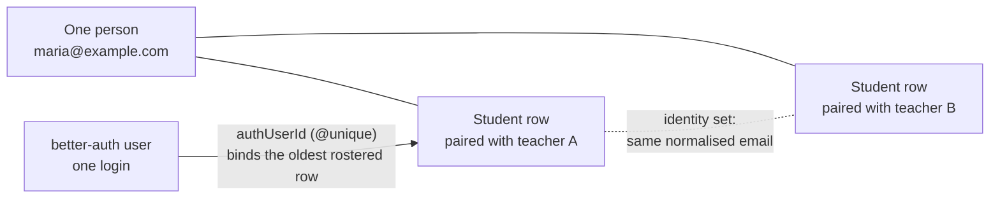

# Multi-teacher students — the identity model

A human being who studies with two teachers is **two `students` rows**, each
paired with its teacher through `teacher_students`, joined at read time by an
identity aggregation — not one global record. `students.email` is deliberately
**not** globally unique.

This is the most consequential modelling decision in the schema: it shapes the
route groups, the credit model and every compliance flow. Reversing any rule
below takes a decision record.

## Mutual exclusivity

This document is about **one person, many per-teacher rows**. Separately, and
orthogonally, **teacher and student are mutually exclusive roles per login**
([D-40](../decisions/D-40.md)): one human cannot be a teacher-payee and a
student-payer under the same identity.

That exclusivity is enforced at every entry point — sign-in linking
(`resolveLinkedStudent`, `lib/auth/student-link.ts`), teacher provisioning
(`requireTeacher`, `lib/auth.ts`), checkout roster creation
(`findOrCreateRosterStudent`) and manual roster add (`createStudentAction`) —
and fails loud with a clear message rather than silently merging two
identities. The product rules are in [user-roles.md](../features/user-roles.md).

## The rules

- **One `Student` per (teacher, person)**, enforced by an advisory-locked
  find-or-create (`lib/students/find-or-create.ts`) rather than by a unique
  index — the invariant is per-(teacher, email) and the column is not unique.
- **`Student.authUserId` is `@unique`.** One login binds exactly one row: the
  oldest rostered match, resolved by `lib/auth/student-link.ts`.
- **The multi-teacher experience is read-time aggregation over the identity
  set.** `studentIdentityIds` (`lib/students/identity.ts`) is the linked row
  plus every non-moderated sibling row sharing the same normalised email.
- **Compliance flows use a wider set.** `studentComplianceIds` also includes
  moderated rows, because a disabled row still holds the person's data.
- **A purchase lands on one pairing.** `purchasingLinkFor` picks the oldest
  non-archived `teacher_students` row for that teacher across the identity set,
  so the price a page shows and the price checkout charges resolve against the
  same row.
- **Read-side only.** Rows are never consolidated and fields never propagate
  between them. Same inbox ≠ same person — a parent can enrol two children under
  one address.
- **Never unify to a global `Student`, and never add a global unique index on
  email.** Consent scoping, archive semantics, per-teacher pricing and GDPR
  deletion all depend on per-teacher rows.

### The sanctioned exceptions

They are scoped to the **mailbox** rather than to the person, which is what
makes them safe:

| Applies across the identity set | Stays per row    |
| ------------------------------- | ---------------- |
| Email opt-out                   | WhatsApp consent |
| Push opt-out                    | Timezone         |
| Lifecycle notification prefs    |                  |

Email preferences describe an inbox, so they belong to the address. WhatsApp
consent is tied to the phone number captured at a specific checkout, so it
cannot be. Timezone is per row on purpose: the portal displays in the linked
row's zone, and a sibling row's zone only affects that row's email formatting.

## What reads across the set

- **The student portal.** `/my-classes` reads and acts across the identity set,
  so `(student)/` has no "current teacher" concept and is its own route group.
  Sign-in heals email-change drift across the rows
  (`lib/students/email-change.ts`).
- **Credits.** Fungible only within one
  `(teacher, identity set, class length, seats)` pool
  (`lib/booking/credit-ledger.ts`).
- **Push delivery.** The notification dispatcher looks up web-push
  subscriptions across every non-moderated row sharing the recipient's email
  (`lib/notifications/dispatcher.ts`), so push reaches the browser whichever
  teacher's row is the target.
- **Compliance.** Deletion requests fan out to every compliance-set row
  idempotently, and cancelling clears the whole set
  (`lib/account-deletion/requests.ts`). A data export returns every row's
  snapshot (`buildStudentIdentityExport`). The unsubscribe footer link silences
  every same-email row.

Duplicate detection and merging (`lib/students/duplicates.ts`,
`lib/students/merge.ts`) refuse cross-tenant merges for the same reason rows
are never consolidated.

Covered by `apps/web/tests/students/identity.test.ts`,
`apps/web/tests/students/compliance.integration.test.ts` and
`apps/web/tests/redirects/email-opt-out-handler.test.ts`.

## Related

- [Data model](data-model.md) — tenancy, money, concurrency, migrations
- [D-40](../decisions/D-40.md) — role exclusivity
- [Student management](../features/student-management.md) — the product surface
- [Account settings](../features/account-settings.md) — export and deletion
