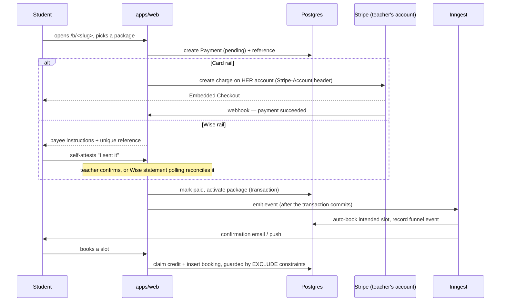
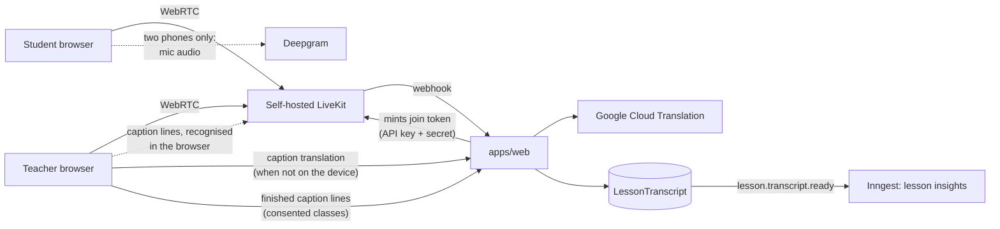

# Architecture overview

How SpiralClass is put together and why the boundaries fall where they do. For
product behaviour see [features](../features/); for the reasoning behind a
choice see the [decision record](../decisions/README.md) it names.

## The shape, in one paragraph

One Next.js application talks to one Postgres database. Background work that
must outlive a request goes to Inngest. Real-time video is separate
infrastructure. Everything else — the teacher dashboard, the student portal, the
public booking funnel, the admin console and every route handler — is the same
deployment, the same process, the same connection pool.

There is no service mesh, no message broker to operate, no separate API tier and
no microservice boundary. The system is maintained by one person, and every
boundary is something that can drift.

## Components

### `apps/web` — the application

Next.js on the App Router with React 19, built as a standalone Docker image.

**Route groups partition by audience, not by URL segment.**

| Group            | Audience                           | Notes                                                                                                                                                  |
| ---------------- | ---------------------------------- | ------------------------------------------------------------------------------------------------------------------------------------------------------ |
| `(app)/`         | Teacher surfaces                   | `/dashboard`, `/payments`, `/settings`, `/onboarding`, `/notifications`. The layout resolves or provisions the `Teacher` row and identifies to PostHog |
| `(student)/`     | Student portal (`/my-classes/*`)   | **No "current teacher" concept exists here** — a student can belong to several teachers                                                                |
| `(auth)/`        | Sign-in and sign-up                | Passwordless                                                                                                                                           |
| `b/[slug]/`      | Public booking and checkout funnel | Rendered in the _teacher's_ chosen buyer language, never the visitor's                                                                                 |
| `admin/`         | Internal operations                | See [Authorisation](#authorisation)                                                                                                                    |
| `api/**`         | Route handlers                     | One tree, grouped by caller: `teacher` · `student` · `chat` · `admin` · webhooks (`stripe`, `livekit`, `resend`) · `inngest` · …                       |
| `r/`, `g/`, `i/` | Token and short-link surfaces      | `r/` one-click token links from email · `g/<code>` the tracked acquisition link · `i/<token>` invitation landing                                       |

**`src/middleware.ts` is load-bearing at exactly that path.** Next.js loads
middleware only from there; a copy at `apps/web/middleware.ts` compiles and is
never invoked. It carries the CSP nonce, the session-cookie gate, auth
redirects and `?ref=` attribution — all four would go dormant in production
without a single error. Guarded by
`apps/web/tests/config/middleware-placement.test.ts`.

**`src/lib/` is organised by bounded concern**, one folder per domain
(`payments/`, `booking/`, `cancellation/`, `subscriptions/`, `auth/`,
`notifications/`, `webhooks/`, `inngest/`, `video/`, `captions/`,
`transcription/`, `chat/`, `homework/`, `library/`, `marketing/`, `tenancy/`, …)
plus flat single-file utilities (`money.ts`, `dates.ts`, `slots.ts`). Tests sit
next to the module they cover. Extending a domain means adding to its folder.

Branching around these resolvers is the bug they exist to prevent:

- **`entitlementsFor()`** (`lib/subscriptions/entitlements.ts`) is the only
  place tier logic is decided. Nothing else branches on plan or tier.
- **`getStripeClient()`** (`lib/stripe/index.ts`) resolves the platform Stripe
  credentials at every call site, so swapping the platform's legal entity is a
  credential change in the deployment environment, not a code change.
- **`getVideoProvider()`** (`lib/video/provider.ts`) — the `VideoProvider`
  interface selected by `RTC_PROVIDER`; LiveKit is the only implementation.
- **`getEmailClient()`** (`lib/email/index.ts`) — the transactional email
  transport.

### `packages/shared` — the business rules

Wire types, Zod validators, money arithmetic, pricing and subscription
configuration, the language registry, the i18n catalog, legal copy — anything
the route handlers and the UI must agree on. Presentation does not live here.
Every module with non-trivial logic has a colocated test.

### `packages/livekit-activity-cli` — an operator tool

A small standalone CLI for inspecting room and participant activity. Not
imported by anything.

## Data model

Postgres on Neon, through Prisma. **[`data-model.md`](data-model.md) is the
full treatment** — tenancy, the per-teacher student identity model, money
columns, the booking constraints and migration discipline. Two properties shape
everything above the database:

- **Tenancy is application-level `teacherId` scoping, and nothing else.** There
  is no row-level security.
- **A student belongs to several teachers.** That is why `(student)/` has no
  current-teacher concept — see
  [`multi-teacher-students.md`](multi-teacher-students.md).

## Request and money flow

### A student buys a package and books a class

Two boundaries in that diagram are load-bearing.

**The charge is created on the teacher's account, not the platform's.** She is
the merchant of record; there is no `Transfer`, no balance-transaction
read-back and no reversal-on-refund path, because the platform never holds the
money. See [D-143](../decisions/D-143.md) and
[payments.md](../features/payments.md).

**The event is emitted after the payment transaction commits.** A failed
statement poisons a Postgres transaction even when its JavaScript error is
caught, so a best-effort write inside it can take the payment down. Analytics
and funnel writes stay strictly outside the transaction boundary.

### Video

The application talks to LiveKit only through the `VideoProvider` interface,
so moving from LiveKit Cloud to the self-hosted box was a configuration change
([D-16](../decisions/D-16.md)). That box has no Egress, so class recording is
off in production; the room-composite recording code remains, behind
`CLASS_RECORDING_ENABLED`.

Captions are recognised in a participant's browser (or, when neither browser
can, streamed from the speaker's own browser to Deepgram), translated on the
device or through `/api/captions/translate`, and published into the room. With
the transcription flag on and the pairing's recorded insights consent, the
finished lines are kept as text — the class's `LessonTranscript` — which the
lesson-insights pipeline reads. No audio is captured for it. Which browser
recognises whom is [D-185](../decisions/D-185.md); the behaviour is
[live-calls-video.md](../features/live-calls-video.md) and
[lesson-insights-reports.md](../features/lesson-insights-reports.md).

## Cross-cutting concerns

### Authorisation

Application-level `teacherId` scoping is the **only** tenant isolation, checked
twice by the application rather than by Postgres
([D-175](../decisions/D-175.md)) — see
[data-model.md](data-model.md#tenancy-application-level-scoping-and-nothing-else).
[`SECURITY.md`](../../SECURITY.md) treats a missing `where teacherId = ?` on an
admin, webhook or service query as a reportable vulnerability.

Admin access is an `admin_users` row: a role on a rank ladder plus narrow
capabilities, behind mandatory TOTP step-up ([D-25](../decisions/D-25.md),
`lib/admin.ts`). The `SUPERUSER_EMAILS` env allowlist is a bootstrap path that
applies only while `admin_users` is empty, and the built-in
`BUILTIN_SUPERUSERS` set is empty, so it cannot re-arm once rows exist.

Route handlers that take a plain `Request` gate on `@/lib/api/auth`
(`requireApiOnboardedTeacher`, which throws `ApiAuthError`) and wrap in
`@/lib/api/route`'s `handle()`, which turns that into a JSON body. Page routes
use `@/lib/auth`'s `requireOnboardedTeacher`, which redirects. Pick by whether
the caller is a `fetch()` or a browser navigation.

### Validation

Zod schemas in `packages/shared` are the wire contract; server actions and
route handlers both validate against them rather than re-declaring a schema
(a re-declared one once dropped a `.min(1)` and let an empty availability
ruleset wipe a teacher's schedule). Grep the shared schema before assuming a
route's input shape.

### Configuration

Three tiers, split on one question — _is this a credential?_

| Tier                 | Where                                             | Example                                             |
| -------------------- | ------------------------------------------------- | --------------------------------------------------- |
| Non-secret           | `config/env/<env>.{build,runtime}.env`, committed | URLs, publishable keys, feature flags, project ids  |
| Secret               | Infisical, pushed to one Cloud Run secret         | Stripe secret key, LiveKit API secret, database URL |
| Infrastructure-owned | Read from OpenTofu state by that same push        | The production R2 bucket credentials                |

The non-secret tier is committed so a deployment's configuration is
reviewable in a diff. The third tier never appears in the repository
(`scripts/cloudrun-env.mjs` composes it), so check the deployed secret set, not
a grep, before concluding a variable is unset.

`src/lib/env.ts` is the runtime contract. Almost everything is optional and
degrades gracefully; only `assertProductionCredentials()` hard-fails, and only
on the production deployment.

### Internationalisation

Key-based catalog in `packages/shared`, resolved by `getT()` in Server
Components and `useT()` in Client Components, enforced by an ESLint rule and a
guard test that fails on any hardcoded literal. A teacher has four independent
language columns, and the public funnel renders in `booking_page_locale` —
pages, client layout and social card alike — never in the visitor's locale.
Mechanics and the four columns: [i18n.md](../development/i18n.md) and
[D-72](../decisions/D-72.md).

### Background processing

The dividing line is durability: anything that must survive the request
ending, retry on failure, or run on a schedule goes to Inngest
(`lib/inngest/`, served at `/api/inngest`). Everything else stays in the
request. That covers booking side-effects, reminder scanning and dispatch,
payment reconciliation, Wise statement polling, the lesson-insights pipeline,
package-expiry and homework nudges, subscription sweeps, account deletion and
calendar sync. Every cron fires on minute `:00`; sub-hourly precision comes
from a delayed event instead ([D-115](../decisions/D-115.md)).

`lib/jobs/` is a provider-agnostic seam beside it: `enqueue()` routes by
`JOBS_BACKEND`, which defaults to `inngest`. Setting it to `pgboss` boots an
in-process pg-boss worker from `instrumentation.ts`; nothing sets it today,
and D-115 records why switching it on would exhaust the Neon allowance.

### Observability

Sentry for errors, with noise filters and a scrubber; PostHog for product
analytics, proxied through the app's own `/ingest` path so an ad blocker does
not erase the funnel. Production probes run at the end of every production
deploy (`.github/workflows/deploy-production.yml`), the moment a deploy could
have broken something.

## What was reversed

Each was cheap because the thing swapped sat behind one resolver; the records
hold the reasoning.

| Area             | From → to                                                                         | Record                                                       |
| ---------------- | --------------------------------------------------------------------------------- | ------------------------------------------------------------ |
| Hosting          | Vercel + Supabase → Fly.io + Neon → Google Cloud Run + Neon                       | [D-70](../decisions/D-70.md), [D-184](../decisions/D-184.md) |
| Payments         | Separate charges and transfers → direct charges on the teacher's own account      | [D-143](../decisions/D-143.md)                               |
| Platform billing | Moved to GBP under the UK entity                                                  | [D-153](../decisions/D-153.md)                               |
| Video            | LiveKit Cloud → self-hosted                                                       | [D-16](../decisions/D-16.md)                                 |
| Subject scope    | English-teaching → any subject, a BCP-47 code from one registry                   | [D-72](../decisions/D-72.md)                                 |
| CI               | One check registry, run by the laptop's pre-push hook and by GitHub runners alike | [D-157](../decisions/D-157.md)                               |
| Second client    | Strict parity → web-only; the mobile client and its route tree deleted            | —                                                            |

Production versus preview is decided by `APP_URL`, never by a platform
variable, which is why a hosting move needs no application change.

## Related

- [Data model](data-model.md) — tenancy, identity, money, concurrency, migrations
- [Multi-teacher students](multi-teacher-students.md) — the identity model
- [ERD generation](ERD.md) — the live schema diagram
- [Development workflow](../development/workflow.md) — how a change ships
